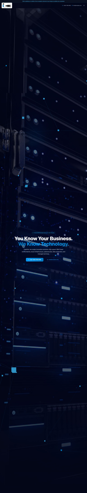

# ICE Sales Landing Site

[](https://github.com/MDCran/ice-website-landing/actions/workflows/security-checks.yml) [](https://github.com/MDCran/ice-website-landing/actions/workflows/codeql.yml)

A Next.js marketing site for International Computer Exchange, combining an animated landing page with solution pages, resource browsing, and contact/subscription forms.

The project showcases responsive interface composition, reusable visual effects, and server-side form/data routes. It is a separate codebase from the [ICE website and CMS](https://github.com/MDCran/ice-website).

[Documented website](https://icesales.com/) · [Landing page source](src/app/page.tsx) · [API routes](src/app/api)

## Preview



This committed screenshot was captured from the documented website. It illustrates the interface rather than verifying the site's current deployment or business results.

## Stack and architecture

- **Frontend:** Next.js 16 App Router, React 19, TypeScript, and Tailwind CSS 4.
- **Visuals:** Motion, GSAP, Three.js/React Three Fiber, and reusable interaction effects.
- **Data:** Next.js route handlers with Mongoose/MongoDB for contacts, subscriptions, and resources.
- **Tooling:** npm lockfile, ESLint 9, and Next.js build scripts.

Exact versions are in [package.json](package.json).

| Path | Responsibility |
| --- | --- |
| [src/app/page.tsx](src/app/page.tsx) | Main landing experience |
| [src/app/solutions](src/app/solutions) | Service-specific pages |
| [src/components/effects](src/components/effects) | Motion and interaction effects |
| [src/components/three](src/components/three) | Three.js visual components |
| [src/app/api](src/app/api) | Contact, subscription, resource, and admin-auth routes |
| [src/lib/mongodb.ts](src/lib/mongodb.ts) | Connection caching and Mongoose models |
| [public](public) | Static assets |

## Local development

Requires Node.js 20.9 or newer and npm.

```bash
npm ci
npm run dev
```

Open [localhost:3000](http://localhost:3000). Edit `src/app/page.tsx` to work on the landing page.

### Optional backend configuration

Create an uncommitted `.env.local` when exercising data-backed features:

| Variable | Purpose |
| --- | --- |
| `MONGODB_URI` | Connection URI for an isolated development database |
| `ADMIN_PASSWORD` | Local administrator password used by the admin and resource routes |

Use synthetic submissions and a unique local password. Keep credentials out of source control.

Important development behavior: without `MONGODB_URI`, the [contact](src/app/api/contact/route.ts) and [subscription](src/app/api/subscribe/route.ts) endpoints return a success response **without saving the submission**. The [resource API](src/app/api/resources/route.ts) requires a database. A success message in an unconfigured local preview does not verify persistence.

## Validation and security checks

```bash
npm run lint
npm run build
# Serve the production build locally:
npm start
```

The package currently has no automated application test script.

- [CodeQL](.github/workflows/codeql.yml) analyzes JavaScript/TypeScript on pushes, pull requests, and a weekly schedule.
- [Security checks](.github/workflows/security-checks.yml) installs locked dependencies, runs `npm audit --audit-level=high`, and checks whitespace.
- The audit step is **non-blocking** (`continue-on-error: true`). A green badge can coexist with dependency advisories; inspect the [workflow logs](https://github.com/MDCran/ice-website-landing/actions/workflows/security-checks.yml).
- These workflows do not run lint, build, browser tests, or database-backed form tests.

Badges show workflow status, not a vulnerability-free guarantee. Review authentication, validation, and deployment configuration before using this code with real users or sensitive data.

## Framework and deployment references

The project uses [next/font](https://nextjs.org/docs/app/getting-started/fonts) to load [Geist](https://vercel.com/font).

- [Next.js documentation](https://nextjs.org/docs)
- [Learn Next.js](https://nextjs.org/learn)
- [Next.js source](https://github.com/vercel/next.js)
- [Next.js deployment documentation](https://nextjs.org/docs/app/getting-started/deploying)
- [Vercel](https://vercel.com/new)

A deployed copy needs its own environment configuration and MongoDB database for persistence. Verify the form and resource flows against an isolated environment before publishing.
